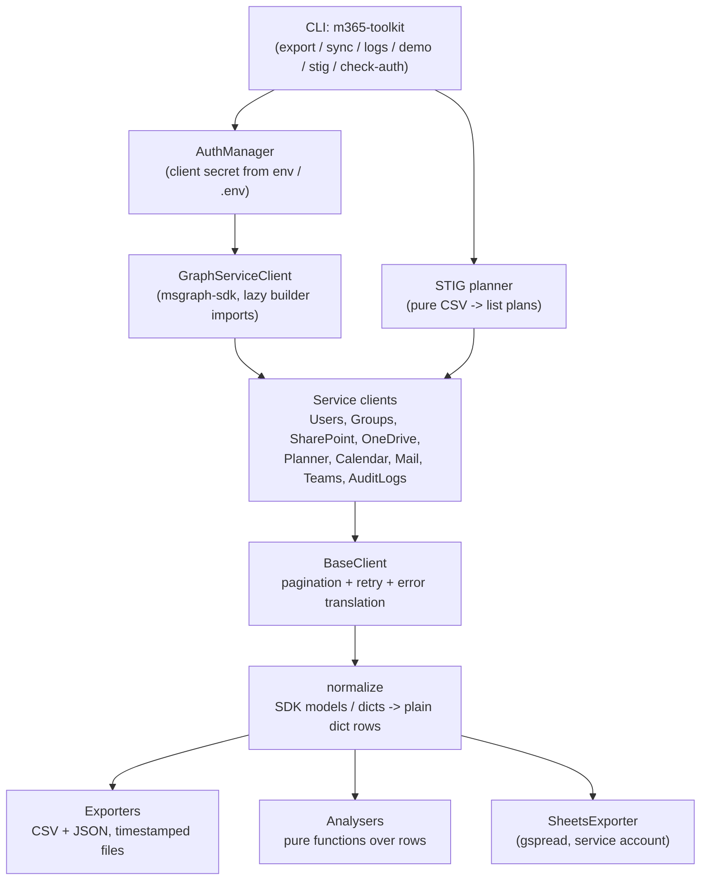

# M365 Graph Toolkit

Export and analyse Microsoft 365 data from one installable Python package and CLI: users, groups and teams, SharePoint sites and lists, OneDrive usage, Planner plans and tasks, calendars, mail, Teams channel messages, and audit logs, through the Microsoft Graph API. It can also sync users and mail into Google Sheets, and plan and import DISA STIG CSV exports as SharePoint lists (library only).

> **No live tenant run yet.** The SDK builder chains were checked against the installed `msgraph-sdk` source and every offline behaviour is tested, but auth, pagination, `$search`, photo content, and upload/download against a real tenant still need a maintainer run. The 2.1.0 additions (Planner, calendar, mail, channel messages, STIG import), the 2.2.0 Google Sheets sync (its `gspread` call shapes were checked against the installed package instead), and the 2.3.0 staff-review fixes are likewise untested against a live tenant. See [Live check](#live-check).

## Description

The toolkit is a typed, test-gated rewrite of three older codebases that were folded in over October 2026 (see [CHANGELOG.md](CHANGELOG.md)): a July 2026 Graph exporter that did not run, a February/May 2026 Planner/calendar/mail/Teams/STIG codebase, and an October 2025 / May 2026 Graph-to-Google-Sheets sync. What survived each fold-in is the part that was not already covered, on one shared plumbing layer: a single `GraphServiceClient`, shared pagination through `odata_next_link`, and retry only on 429/502/503/504 with exponential backoff (capped at 30s, with jitter, honouring `Retry-After`).

Everything a client returns is a plain `dict` row with `snake_case` field names, so the same rows feed the CSV/JSON exporters, the pure analysers, and your own code without shape conversions. Construction never touches the network and never reads the environment — the CLI builds an `AuthManager` and passes its client in — which is what makes the clients unit-testable with fake Graph clients and no credentials.

What it does **not** do: it is not a migration tool, not a backup tool, and not a server. There is no daemon, no database, and no web UI. Writes (user create/update/delete, list-item and drive-item writes, Planner/SharePoint list creation, STIG imports, Sheets sync) exist in the library, and only the Sheets sync is exposed on the CLI. Deletes are permanent: confirm before calling.

## Prerequisites

- **Python 3.10+** (CI tests 3.10, 3.11, 3.12, and 3.13).
- **An Entra ID app registration** with **application** permissions for what you need (for example `User.Read.All`, `Group.Read.All`, `Sites.Read.All`, `AuditLog.Read.All`, `Files.Read.All`, `Tasks.Read.All`, `Calendars.Read.All`, `Mail.Read`, `ChannelMessage.Read.All`), admin consent granted, and a client secret. Add `Sites.Manage.All` only if you plan to import STIG lists.
- **For Google Sheets sync only:** a Google Cloud service account with **Editor** access to the target spreadsheet. The Sheets writer uses the `spreadsheets` scope and **clears the target worksheet before writing** — a sync replaces that worksheet's contents, so first runs should point at a test spreadsheet.
- **For STIG imports only:** DISA STIG CSV exports, downloaded from the [DISA STIG Library](https://public.cyber.mil/stigs/) (or your organisation's approved source). STIG CSVs are **not** bundled with this repository — they are DISA publications, updated quarterly, and 46 MB in bulk in the old codebase.
- No other services, databases, or accounts are required. The offline `demo` command needs nothing at all.

## Installation

From a checkout:

```bash
pip install -e ".[graph]"
```

| Install | What it enables |
|---|---|
| `pip install -e .` (base) | Offline `demo` command, exporters, and analysers only. |
| `pip install -e ".[graph]"` | Live Graph commands (`azure-identity`, `msgraph-sdk`). |
| `pip install -e ".[graph,sheets]"` | Live Graph commands **plus** Google Sheets sync (`gspread`, `google-auth`). |
| `pip install -e ".[dev]"` | Everything above, plus ruff, mypy, and pytest for development. |

Set credentials by copying the example file and filling it in, or by exporting the variables directly. The CLI loads a `.env` file from the working directory when `python-dotenv` is installed. Nothing in this project logs or prints a secret or a token value.

```bash
cp .env.example .env
# fill in MS_TENANT_ID, MS_CLIENT_ID, MS_CLIENT_SECRET
# for Sheets sync, also GCS_SERVICE_ACCOUNT_KEY_JSON and TARGET_GOOGLE_SHEET_ID
```

Check the credentials work (prints only the token expiry, never the token):

```bash
m365-toolkit check-auth
```

## Use

Every export writes a timestamped CSV **and** JSON file into the directory you name. Nothing is deleted, overwritten, or written inside the package directory.

```bash
# All users
m365-toolkit export users --out ./exports

# Group memberships for every user
m365-toolkit export memberships --out ./exports

# Teams and their composition + analysis
m365-toolkit export teams --out ./exports

# SharePoint sites
m365-toolkit export sites --out ./exports

# OneDrive quota + item counts per user
m365-toolkit export onedrive --out ./exports

# Sign-in logs for the last 7 days (plus an analysis file)
m365-toolkit logs sign-ins --out ./exports --days 7
m365-toolkit logs sign-ins --out ./exports --days 30 --user <user-id>

# Planner plans and their tasks (via each group's plans)
m365-toolkit export planner --out ./exports

# One user's calendar events
m365-toolkit export calendar-events --out ./exports --user <user-id-or-upn>

# One user's Outlook messages
m365-toolkit export mail --out ./exports --user <user-id-or-upn>

# One Teams channel's messages
m365-toolkit export channel-messages --out ./exports --team <team-id> --channel <channel-id>

# Sync users / one user's mail into Google Sheets (replaces the worksheet)
m365-toolkit sync users --dry-run
m365-toolkit sync users --spreadsheet <sheet-id> --worksheet users
m365-toolkit sync mail --user <user-id-or-upn> --dry-run
m365-toolkit sync mail --user <user-id-or-upn> --spreadsheet <sheet-id>
```

A dry run fetches from Graph and reports the row count without touching Google Sheets — it needs no Sheets credentials. A real sync builds the Sheets exporter only after the fetch succeeds, and missing Sheets configuration exits non-zero before any fetch. Pass the service-account key as a file path or environment variable where you can: a JSON key passed on the command line with `--service-account` lands in shell history.

Try it without credentials or a tenant — fictional data only:

```bash
m365-toolkit demo --out ./demo-output
```

### STIG imports (preview is read-only; import is library-only)

Preview what would be created, without credentials and without touching a tenant:

```bash
m365-toolkit stig preview --dir ./stig-csvs --out ./exports
```

Each CSV becomes one SharePoint list named after the file. Its `Vuln ID` column maps to the list's `Title` column; every other header becomes a multi-line text column; `_UIVersionString` is skipped. A CSV with no `Vuln ID` header, duplicate headers, or no data rows fails planning loudly instead of creating an empty or wrong list. A fictional sample in STIG column shape lives at [`examples/Fictional Example STIG.csv`](examples/Fictional%20Example%20STIG.csv) for preview testing.

Importing writes to a tenant, so it is library-only — there is no CLI path to it. `examples/stig_import.py` previews, asks for a typed `YES`, then calls `SharePointClient.import_lists_from_directory` with the site id you supply. Columns are polled until provisioned before any item is written; per-row failures are counted in the returned summary instead of aborting the import.

### Library

```python
import asyncio
from m365_graph_toolkit.auth import AuthManager
from m365_graph_toolkit.clients import UsersClient, AuditLogsClient

async def main() -> None:
    users = UsersClient.from_auth(AuthManager())
    all_users = await users.get_users()
    memberships = await users.get_user_memberships_batch(all_users)

    logs = AuditLogsClient.from_auth(AuthManager())
    sign_ins = await logs.get_audit_logs(log_type="signIn", days=7)

asyncio.run(main())
```

Examples live in [`examples/`](examples/). Write operations (`create_user`, `update_user`, `delete_user`, list-item and drive-item writes, Planner/SharePoint list creation, and STIG imports) exist in the library only — there is no CLI path to them.

### What the analysers expect

Analysis functions in `m365_graph_toolkit.analysis` are pure functions over the clients' rows:

- `analyze_team_membership(members_by_team)` — team sizes, empty teams, users in multiple teams.
- `analyze_onedrive_usage(stats)` — storage tiers, users over 75% of quota, error entries counted separately. Negative storage values raise instead of being reported as measurements.
- `analyze_sign_in_logs(logs)` — success/failure counts from `status.error_code`, top users/apps/IPs, error distribution.
- `is_internal_user(user, domain)` — mail **or** UPN ending in the domain you pass. The domain is always an explicit argument; nothing is hardcoded.

### Rate limits

List methods page through `odata_next_link` and retry 429/502/503/504 responses with exponential backoff (capped at 30s, with jitter), honouring `Retry-After` when Graph sends one. Other failures (400/401/403/404) fail immediately — a permission problem should never look like a slow tenant. A run that retried is logged as such; do not present a throttled collection as a complete measurement.

OneDrive simple upload supports files under 4 MB. Larger files raise an error: Graph requires a resumable upload session for them, which this client does not implement.

`GET /sites` without search returns only a subset of sites in some tenants (followed/recently accessed). For a full tenant inventory, use search-based discovery against your tenant and treat `export sites` output as what Graph returned, not as a census.

## Architecture



The source of this diagram is [`docs/architecture.mmd`](docs/architecture.mmd); keep the two in sync when the layering changes. The key design decisions are: construction never touches the network (so every client is testable with a fake), SDK builder classes are imported lazily inside methods (so the package imports without `msgraph-sdk` installed), and validation runs before any SDK import in the model builders (so a bad plan raises `ValidationError` even on a base install).

## Screenshots and visual assets

No screenshots are shipped yet, deliberately: captures must come from the fictional `demo` output or a test tenant, never from a real tenant's data. The capture plan, with exact commands and filenames, is in [`docs/visual-assets.md`](docs/visual-assets.md). In short, the assets to add, in README placement order, are:

1. **Animated GIF, top of this README under the intro** — `docs/assets/demo-run.gif`: a terminal recording of `m365-toolkit demo --out ./demo-output` followed by listing the 24 output files. This is the first thing a visitor sees and it proves the tool runs with no credentials.
2. **Screenshot, in Use after the export examples** — `docs/assets/demo-csv.png`: the demo users CSV open in a spreadsheet, showing the `snake_case` header row. It makes the output shape concrete without reading code.
3. **Screenshot, in Use after the sync examples** — `docs/assets/sheets-sync.png`: the test spreadsheet after `sync users`, header row plus fictional users, with the worksheet tab visible. It proves the Sheets sink end-to-end.
4. **Architecture diagram, in Architecture above** — already present as Mermaid (no external file needed); its source is `docs/architecture.mmd`.

Do not add `` links for 1–3 until the captures exist; a broken image link in a README is worse than no image.

## Local Development

```bash
pip install -e ".[dev]"
ruff check src tests examples && ruff format --check src tests examples
mypy src
python -m pytest -q
```

Tests use fake Graph clients — no credentials, no network. The `demo` command is the offline end-to-end smoke test. The test suite has two tiers, and CI runs both:

- **Full suite** (default job, Python 3.10–3.13): `pip install -e ".[dev]"`, then the lint, type-check, and test commands above.
- **Base-install job** (Python 3.12): `pip install -e .` plus pytest only, then `m365-toolkit demo --out ./demo-output` and `python -m pytest -q --ignore=tests/test_sdk_shapes.py -m "not graph"`. Tests that genuinely need to build real SDK models are marked `@pytest.mark.graph` and are excluded there; the `gspread` shape test skips itself without `gspread` installed.

If you add a client method, add a fake-client test in the matching `tests/test_*.py` file and a builder-chain assertion in `tests/test_sdk_shapes.py` where the SDK surface is new. If you add an optional dependency, mark the tests that need it and check the base job still passes.

## Deployment

This project deploys as a published repository and a CLI install, not as a service — there is no server, database, or background process to run.

**Publish the repository.** Create an empty GitHub repository (no README, license, or `.gitignore` from GitHub), extract the release zip into a fresh folder, add the remote, and push `main`. CI runs on every push to `main` and every pull request. Do not force-push over a remote that has moved ahead; rebuild from the live tip instead.

**Install on a target machine.** Clone or download the repository, then `pip install -e ".[graph]"` (or `".[graph,sheets]"` for Sheets sync) and set the credentials from [Installation](#installation). There is no configuration file to deploy beyond `.env`, and `.env` must never be committed (`.gitignore` excludes it, along with `exports/`, `raw/`, and `*.csv`).

**Schedule exports or syncs (optional).** Do not schedule a sync on push: if you automate it, use a `workflow_dispatch`-only workflow (manual or scheduled trigger, never `push`), with `MS_TENANT_ID`, `MS_CLIENT_ID`, `MS_CLIENT_SECRET`, `GCS_SERVICE_ACCOUNT_KEY_JSON`, and `TARGET_GOOGLE_SHEET_ID` stored as repository secrets, and point the first runs at a test spreadsheet. A sync replaces the target worksheet, so a scheduled sync against a production spreadsheet is a data-loss footgun, not a convenience.

**Releases.** Tag a release after the full test suite and the [Live check](#live-check) pass. There is no PyPI publication yet; if one is added, the package name, the `[graph]`/`[sheets]` extras, and the `m365-toolkit` console script in `pyproject.toml` are the only deployment surface that needs to change.

## Live check

After pushing, run from a machine with tenant access:

```bash
pip install -e ".[graph]"
m365-toolkit check-auth
m365-toolkit export users --out ./exports
m365-toolkit logs sign-ins --out ./exports --days 7
```

Confirm: users paginate past the first page, `find_user` returns a match, a team-members export has no double `/groups/groups/` URL errors, and a photo/download round trip works. Report anything that fails with the command and the (redacted) error.

For the 2.1.0 additions, also confirm: a Planner export returns plans with bucket names and checklist counts, a calendar/mail export for one user pages past the first page, a channel-messages export returns sender names, and a STIG preview against one real CSV plans the expected columns before any import is attempted. Do not run the STIG import against a production site first — use a test site.

For the 2.2.0 Sheets sync, also confirm: `m365-toolkit sync users --dry-run` succeeds with only the Graph variables set, a real sync to a **test** spreadsheet creates the `users` worksheet with a header row and the fetched users, a second sync replaces (not appends) its contents, and `sync mail` writes more than 25 messages for a mailbox that has them (pagination past the old first-page cap).

For the 2.3.0 fixes, also confirm: `get_direct_reports` returns more than one page for a manager with many reports, and a sync into a pre-existing worksheet that is smaller than the data grows the worksheet instead of failing.

## Safety

- Real tenant exports are **never** committed. `.gitignore` excludes `exports/`, `raw/`, `*.csv`, and `.env`. The only data in this repository is fictional demo data (`example.com`, invented names, invented GUIDs).
- Exports can contain personal data (names, emails, sign-in IPs). Handle output directories accordingly and do not share them. A Sheets sync copies that data — including mail bodies — into a spreadsheet, so the spreadsheet's sharing settings are the data's sharing settings.
- Client-secret auth is appropriate for unattended exports. Prefer certificate credentials and least-privilege permissions in production; scope the app registration to only the permissions the commands you run need.

## License

MIT. See [LICENSE](LICENSE).
